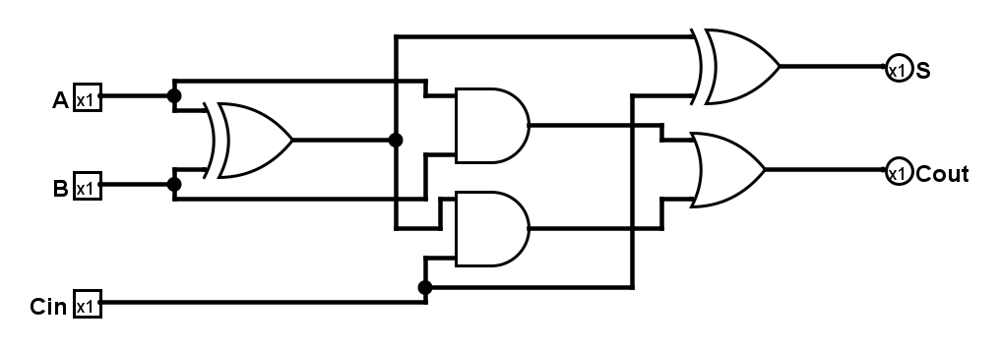
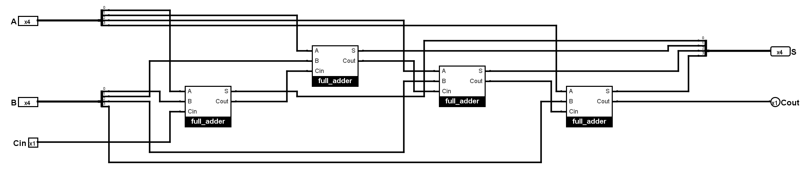
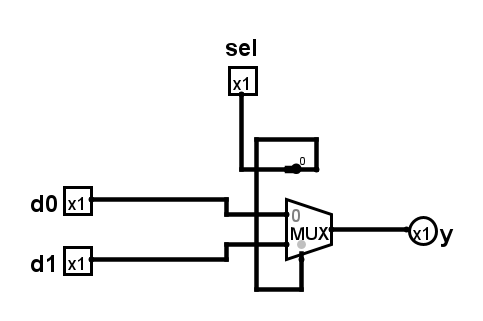
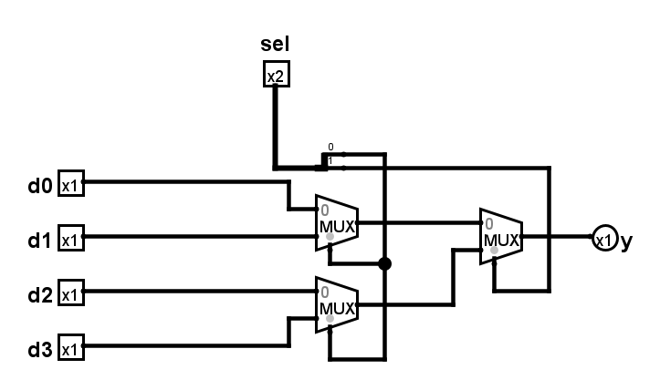
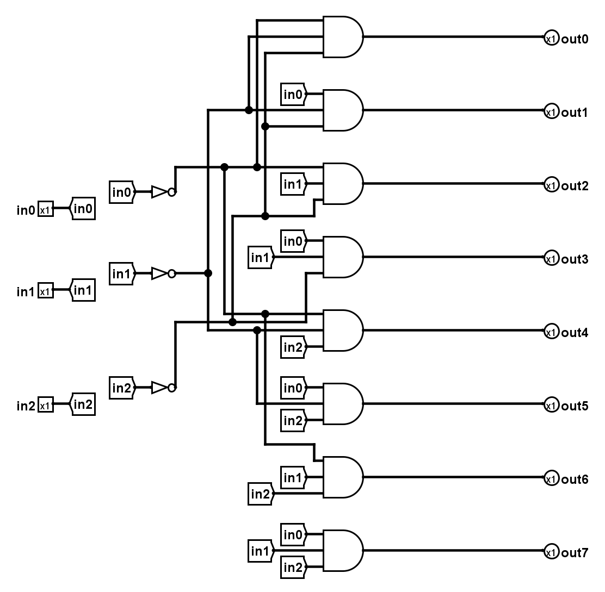
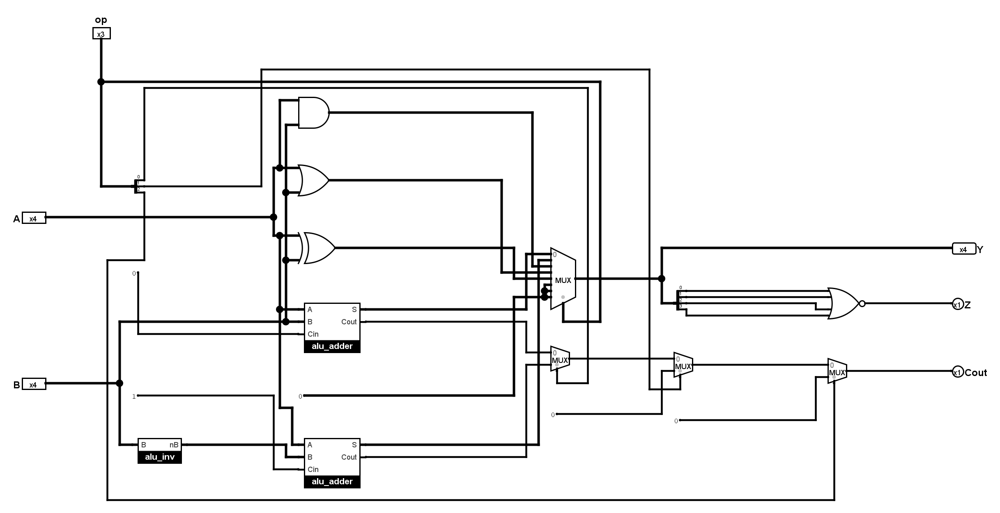
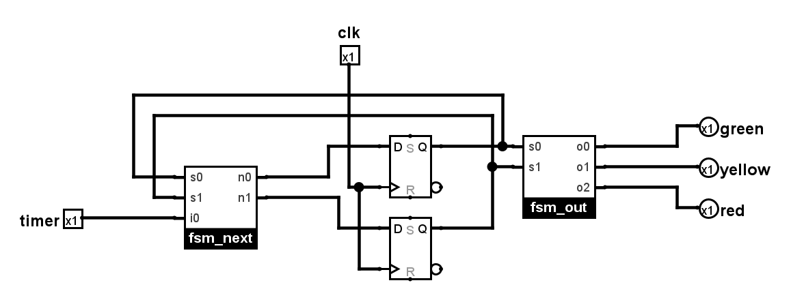
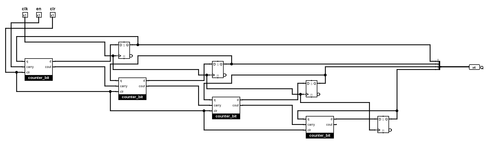

# Logisim toolkit

Build, edit, lint, and verify Logisim-evolution 3.9.0 `.circ` projects from Python, the `logisim-tool` CLI, or an optional MCP server. The core toolkit uses only the Python standard library.

## Installation

Use Python 3.10 or later. For simulation, PNG rendering, and learning component geometry, use the Logisim-evolution 3.9.0 JAR with Java 21 or later. Use a JDK so the toolkit can compile its Java probe with `javac`. Set `LOGISIM_JAR` to the JAR's full path.

From the repository root in PowerShell, put the virtual environment's scripts on the current shell's path. Replace the JAR path with your own.

```powershell
python -m venv .venv
$env:Path = "$(Resolve-Path .\.venv\Scripts);$env:Path"
python -m pip install -e .
$env:LOGISIM_JAR = 'C:\path\to\logisim-evolution-3.9.0-all.jar'
```

Install the optional extras for the MCP server and the test suite.

```powershell
python -m pip install -e '.[mcp]'
python -m pip install -e '.[test]'
```

## Quick start

Run the examples below in an empty working folder with the virtual environment active. Both versions build a two-input XOR and check all four input combinations in Logisim. The CLI's `--png` option renders the preview during generation.

### Python

```python
from logisim import generate, jar, sim
from logisim.builder import Project

circuit = generate.expression_circuit("A ^ B", name="xor", output="Y")
path = Project(circuit).save("xor_api.circ")
result = sim.verify(path, lambda A, B: {"Y": A ^ B})
assert result.ok, result.report()
jar.render_png(path, "xor", "xor_api.png")
```

### CLI

```powershell
logisim-tool gen expr "Y = A ^ B" --name xor -o xor.circ --png xor.png
logisim-tool test xor.circ --expr "Y = A ^ B"
```

## Python API

The examples in this section use `xor.circ` from the CLI quick start where a project is needed.

### Generate

`generate` builds circuits from Boolean expressions, truth tables, and FSM specifications. It also generates standard blocks such as adders, multiplexers, decoders, and counters. Wrap a returned builder `Circuit` in a builder `Project` before saving. Generators that return a `Project` can be saved directly.

```python
from logisim import generate
from logisim.builder import Project

table = generate.truth_table_from_dict(
    {(0, 0): 0, (0, 1): 0, (1, 0): 0, (1, 1): 1},
    inputs=["A", "B"], outputs=["Y"],
)
Project(generate.truth_table_circuit(table)).save("and_table.circ")
```

### Edit

Load a project, edit its in-memory model, then save it. Components can be selected by index, label, or type.

```python
from logisim import edit, io

project = io.load("xor.circ")
edit.rename_pin(project, "xor", "Y", "Result")
edit.save(project, "xor_renamed.circ")
```

### Sim

`sim.truth_table` reads a combinational truth table from the JAR. `sim.verify` checks a Python reference over every input combination up to 14 input bits by default, then uses a reproducible sample for larger inputs. `sim.verify_sequence` compares expected outputs after rising clock edges.

```python
from logisim import sim

table = sim.truth_table("xor.circ")
assert len(table) == 4
print(table.to_text())
```

### Lint

`lint` checks for issues such as floating inputs, conflicting drivers, width mismatches, and layout overlaps. With no circuit name, it checks the entire project.

```python
from logisim import lint

issues = lint.lint_file("xor.circ")
assert not any(issue.severity == "error" for issue in issues), lint.report(issues)
print(lint.report(issues))
```

### Netlist

`netlist.extract` resolves wires, component ports, and same-label tunnels into nets. Use `signature()` to compare connectivity across layouts.

```python
from logisim import io, netlist

project = io.load("xor.circ")
wiring = netlist.extract(project, "xor")
for net in wiring.nets:
    print([port.describe(wiring.circuit) for port in net.ports])
```

### Report

`report` describes circuits, compares projects, and exports interfaces as Markdown or supported combinational circuits as structural Verilog.

```python
from logisim import io, report

project = io.load("xor.circ")
print(report.interface_markdown(project))
print(report.to_verilog(project, "xor"))
```

### I/O and builder

`builder.Circuit` expresses components and connections. `builder.Project.save` places and routes them before writing XML. `io.load` and `io.save` read and write the placed project model.

```python
from logisim import io
from logisim.builder import Circuit, Project

circuit = Circuit("inverter")
circuit.output("Y", circuit.not_(circuit.input("A")))
path = Project(circuit).save("inverter.circ")
project = io.load(path)
io.save(project, "inverter_copy.circ")
```

## CLI

Continue from the CLI quick start in the same working folder. Run the blocks in order. `gen` writes a new project and refuses existing output paths. `edit` and `tidy` default to `<stem>_edited.circ`. Use `--in-place` to replace the input, or `--force` to replace an existing output. Replacements keep a `.bak` copy.

```powershell
# info describes a project and its circuits.
logisim-tool info xor.circ --json
# lint checks wiring and layout.
logisim-tool lint xor.circ --errors-only
# table prints a combinational truth table from Logisim.
logisim-tool table xor.circ --csv
# test checks against Boolean expressions or a Logisim test-vector file.
logisim-tool test xor.circ --expr "Y = A ^ B"
# tidy reroutes a circuit while preserving its netlist.
logisim-tool tidy xor.circ -o xor_tidy.circ
# diff compares circuits, components, and netlists.
logisim-tool diff xor.circ xor_tidy.circ --json
# export writes a net summary, gate counts, Markdown, or structural Verilog.
logisim-tool export xor.circ --verilog -o xor.v
```

### Generation commands

`gen` accepts `expr`, `truth`, `fsm`, and `block`. The block kinds are `adder`, `addsub`, `mux`, `decoder`, `comparator`, `regfile`, `alu`, and `counter`. Prepare a truth table and a state table for the following commands.

```python
from pathlib import Path

Path("table.csv").write_text("A,Y\n0,1\n1,0\n", encoding="utf-8")
Path("states.txt").write_text("""\
states: idle, active
inputs: go
outputs: busy
transitions:
idle,go,active
active,go,idle
state_outputs:
idle,0
active,1
""", encoding="utf-8")
```

```powershell
# gen expr builds gates from Boolean expressions.
logisim-tool gen expr "Y = A & B" --name and_gate -o and_gate.circ
# gen truth minimizes a truth table as sum of products or product of sums.
logisim-tool gen truth table.csv --outputs Y -o truth.circ
# gen fsm builds a clocked state machine from a state table.
logisim-tool gen fsm states.txt -o machine.circ
# gen block builds a standard logic block.
logisim-tool gen block adder --width 4 -o adder.circ
```

### Editing commands

`edit` lists or finds components, or writes a changed project. The examples use distinct output paths.

```powershell
# edit list shows components and their indices.
logisim-tool edit xor.circ list
# edit find filters components by target, label, or type.
logisim-tool edit xor.circ find --type "XOR Gate"
# edit add places a library component.
logisim-tool edit xor.circ add "Buffer" --attr label=spare -o added.circ
# edit delete removes a component and its unused wire stubs.
logisim-tool edit added.circ delete spare -o deleted.circ
# edit move moves a component and reconnects its wires.
logisim-tool edit xor.circ move "XOR Gate" --dy 100 -o moved.circ
# edit rotate rotates a component and reconnects its wires.
logisim-tool edit xor.circ rotate "XOR Gate" --facing north -o rotated.circ
# edit set changes component attributes.
logisim-tool edit xor.circ set Y labelloc=north -o relabeled.circ
# edit rename-circuit updates a circuit name and its references.
logisim-tool edit xor.circ rename-circuit xor parity -o parity.circ
# edit rename-pin updates a pin label.
logisim-tool edit xor.circ rename-pin Y Result -o renamed_pin.circ
# edit insert splices a gate between a driver and its sinks.
logisim-tool edit xor.circ insert Y:p "NOT Gate" -o inserted.circ
# edit delete-wire removes wires by index, point, or endpoints.
logisim-tool edit xor.circ delete-wire --index 0 -o cut.circ
# edit cleanup removes dangling wires and merges safe collinear segments.
logisim-tool edit cut.circ cleanup -o cleaned.circ
# edit add-circuit adds an empty circuit.
logisim-tool edit xor.circ add-circuit control -o control.circ
# edit add-instance places a subcircuit from the same project.
logisim-tool edit adder.circ add-instance full_adder --label spare -o instance.circ
# edit merge copies circuits and their dependencies from another project.
logisim-tool edit xor.circ merge adder.circ --include ripple_adder -o merged.circ
```

## MCP server

Install the `mcp` extra to expose circuit operations over stdio. The workspace directory must exist. See [the MCP server documentation](docs/mcp.md) for tool details and path rules.

A Claude Desktop configuration looks like this. Replace the three paths with your venv's Python, your workspace folder and your JAR.

```json
{
  "mcpServers": {
    "logisim": {
      "command": "C:\\path\\to\\logisim-toolkit\\.venv\\Scripts\\python.exe",
      "args": ["-m", "logisim_mcp.server", "--workspace", "C:\\path\\to\\circuits"],
      "env": {"LOGISIM_JAR": "C:\\path\\to\\logisim-evolution-3.9.0-all.jar"}
    }
  }
}
```

## Examples

From the repository root, run the builder with the virtual environment active. It regenerates the circuit files and Logisim-rendered previews. It exits nonzero if a circuit fails verification or has a lint error.

```powershell
python examples/build.py
```

| Circuit | Behavior | Logisim preview |
| --- | --- | --- |
| [Full adder](examples/full_adder.circ) | Adds two bits and a carry-in. |  |
| [4-bit ripple adder](examples/ripple_adder.circ) | Chains four full-adder subcircuits. |  |
| [2:1 mux](examples/mux_2_to_1.circ) | Selects one of two one-bit inputs. |  |
| [4:1 mux](examples/mux_4_to_1.circ) | Selects one of four one-bit inputs using a tree of 2:1 multiplexers. |  |
| [3:8 decoder](examples/decoder.circ) | Drives one of eight outputs high. Input `in0` is the least significant bit. |  |
| [4-bit ALU](examples/alu.circ) | Selects add, subtract, AND, OR, or XOR with `op` codes 0 to 4. Codes 5 to 7 give zero. |  |
| [Traffic-light FSM](examples/traffic_light.circ) | Starts green, then cycles through yellow and red on rising clock edges with `timer` high. With `timer` low, it holds its state. |  |
| [4-bit counter](examples/counter.circ) | Counts modulo 16 when enabled, with synchronous clear. |  |

## Supported components

The table lists component types with built-in geometry formulas, the builder's cache-backed memory components, and same-project subcircuits. The builder can place formula-backed components through `Circuit.component` where there is no dedicated method. Lint checks use the resolved geometry and report an informational issue when a component's geometry is unknown.

| Library | Components | Builder and geometry details |
| --- | --- | --- |
| Wiring | Pin, Probe, Clock, Constant | Pin and probe bounds use classic binary-display geometry. Probe width adapts to the attached net. Clock is one bit. |
| Wiring | Splitter, Tunnel, Pull Resistor, Bit Extender | `split` and `merge` use least-significant-first order, and split widths must add up to the bus width. Splitter and tunnel bounds are estimated. Tunnels join by label. Lint treats a pull resistor as a driver. Bit Extender geometry uses the default orientation and includes an extra input in input-extension mode. |
| Gates | AND Gate, OR Gate, NAND Gate, NOR Gate, XOR Gate, XNOR Gate | The gate builder requires at least two inputs. Geometry accounts for facing, width, size, and per-input negation. |
| Gates | Odd Parity, Even Parity, NOT Gate, Buffer, Controlled Buffer, Controlled Inverter | Parity uses the multi-input gate geometry. NOT and Buffer have one data input. The controlled gates have a one-bit control input and can share a net with other tri-state drivers under lint. |
| Plexers | Multiplexer, Demultiplexer, Decoder, Priority Encoder, BitSelector | `mux` requires a power of two data inputs, with at least two. `demux` rounds its output count up to a power of two, with at least two. Both builder methods disable the enable port. The builder's `decoder` has one output per select value and exposes enable when passed a signal. Decoder bounds are estimated. `priority_encoder` sizes the input bank to a power of two. BitSelector uses its configured group width. |
| Arithmetic | Adder, Subtractor, Multiplier, Divider, Comparator, Negator, Shifter | Geometry is fixed to the default orientation. Comparator outputs are one-bit flags. Lint permits unconnected carry-in, borrow-in, and the divider's upper input. |
| Memory | D Flip-Flop, T Flip-Flop, J-K Flip-Flop, S-R Flip-Flop, Register | Geometry models classic and Logisim-evolution appearances. Flip-flops are one bit and builder flip-flops default to rising-edge triggering. Lint allows unconnected reset, preset, register enable, and register clear. Register bounds are approximate above 8 bits. |
| Memory | Counter, ROM, RAM | Geometry is learned from the JAR for each uncached attribute set, and the builder uses positional ports. RAM uses separate data input and output. The native Counter's optional ports are recognized by lint. |
| I/O | LED, Button | One-bit ports. The builder has an `led` method. |
| Same project | Subcircuit instances | Geometry supports east-facing instances of auto-generated classic or Logisim-evolution appearances. Builder connections use pin labels. |

## Known limitations

- The JAR's normal launcher refuses to start when forced into AWT headless mode. The toolkit runs `-w` and `-tty table` through the normal launcher without opening the editor. Geometry probing and rendering use a separate headless Java entry point and Logisim's painter.
- In the sequential harness, Logisim's `-tty table` prints outputs top to bottom, then left to right, without column headers. The harness drives inputs from a counter and ROM, uses a `halt` pin to stop, and indexes rows by step. Logisim omits `halt` from the output columns. The harness reads outputs after each rising edge with the next step's inputs applied, which affects Mealy outputs. Use a nonempty sequence and a labeled clock input, `clk` by default.
- Simulation expects labeled pins. Test-vector headers require identifiers matching `[A-Za-z_][A-Za-z0-9_]*`. The CLI's expression tests accept only one-bit variables and outputs.
- Placement breaks each feedback loop at a flip-flop's output and places the flip-flop in the column after its next-state logic, so each Q feeds back one column. Outputs taken from several flip-flops still run across the drawing to the output column, and large sequential designs such as the register file stay dense. Try `compact`, `normal`, or `roomy` spacing and `use_tunnels=True` (`--tunnels` in the CLI). The router can also insert tunnels when wire routing fails.
- Built-in geometry covers the types above. For other built-in components, the toolkit can ask the JAR for ports and bounds and cache the result. Lint skips connection checks where geometry is unavailable. The MCP server rejects projects with external libraries.
- By default, edits refuse a move that overlaps another component, a width change that would cause a connected width mismatch, or an attribute change that would remove a connected port. Inserting a gate on a net with several drivers requires choosing a driver. Tidy refuses unknown geometry and rejects a reroute if its netlist signature changes.
- When creating or renaming circuits, use names that start with an ASCII letter and contain only ASCII letters, digits, or single interior underscores. Logisim can rename other names on load, breaking references.
- The Verilog exporter handles one flat combinational circuit with pins, constants, splitters, tunnels, probes, and the basic AND, OR, XOR, NAND, NOR, XNOR, NOT, and Buffer gates. Other component types, including subcircuit instances and sequential elements, raise an error.

## Testing

From the repository root with the `test` extra installed, run the suite.

```powershell
python -m pytest -q -p no:cacheprovider
```

Tests marked `jar` require the Logisim JAR and Java 21 or later. The test configuration skips them if either is unavailable. The committed example netlist checks use the built-in geometry formulas and run without the JAR.
